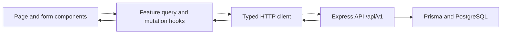

# BINGO CRM Client Agenda

Goal: build a clear, comfortable React workspace for managing companies, contacts, applications, and daily tasks, using shadcn/ui components and the existing Express API.

Backend roadmap: [agenda.md](./agenda.md). Backend implementation is paused after Phase 4 at the user's request on 2026-09-08. Client phase numbers belong to this document and are independent of backend phase numbers.

Status: client Phases 0-5 are implemented and verified in `client/`. Appearance settings (6.6) and a shadcn controls/sidebar refinement (0.8) are additional user-requested slices. Overview, a global default timezone preference, and later phases remain planned. Implementation checkmarks below are updated after verification; user manual checks remain separate.

## Decisions and recommendations

### Confirmed by the user (2026-09-08)

- Business name: **BINGO CRM**, using the supplied blue arrow logo.
- React + TypeScript, built with Vite.
- shadcn/ui components.
- Classic workspace: restrained neutral surfaces, familiar controls, and crisp tables.
- Updated appearance choice: the supplied Amber Stone shadcn tokens are the default, with light/dark/system modes and selectable or shuffled palettes in Settings.
- Left sidebar, page header, and dedicated detail pages.
- Use actual shadcn Select/combobox dropdowns, Calendar with a separate time input, and the shadcn Sidebar inset design with icon collapse and an account dropdown.
- Separate backend and client agendas, with numbered phases and acceptance checks.

### Implementation defaults (2026-09-08)

- Code organization: feature folders, with shared CRUD behavior for the four modules.
- Launch appearance: Amber Stone in light mode, with responsive desktop/mobile layouts. Appearance preferences persist in this browser.

The user authorized implementation through Tasks after the recommendations were presented. The two unanswered preferences initially used the recommended defaults. The subsequent theme request replaces the initial slate-blue accent and adds appearance controls now; backend implementation stays paused.

## Stack architecture

| Responsibility | Tool | Purpose in this app |
| --- | --- | --- |
| UI and build | React, TypeScript, Vite | A separate client application consuming the existing API |
| Components and styling | shadcn/ui, Tailwind CSS, CSS theme variables | Consistent controls, spacing, colors, and focus states |
| Navigation | React Router | Nested workspace routes, direct record links, protected screens |
| API data | TanStack Query + a typed native `fetch` wrapper | Requests, caching, pending states, and refreshing affected records after changes |
| Forms | React Hook Form + Zod | Form state, readable validation, and explicit mapping to API request bodies |
| Tables | TanStack Table with shadcn Table | Reusable columns and controls wired to API pagination, filtering, and sorting |
| Icons | Lucide React | Small, consistent icons alongside readable labels |
| Dates | shadcn Calendar/Popover + time Input, React DayPicker 9, `Intl`, date-fns/date-fns-tz | Calendar/date entry and second-precision time; convert the selected zone's wall-clock value to an API timestamp |
| State | Query cache, URL parameters, local React state, small auth/preferences contexts | Give each kind of state one clear owner |
| Verification | Vitest + React Testing Library; Playwright for important browser journeys | Verify form behavior, API integration, and complete user workflows |
| Package management | npm with a checked-in client lockfile | Independent, repeatable installs in `client/` |

Resolved dependencies are recorded in [client/package-lock.json](client/package-lock.json). The client runs on the existing Node `22.15.1`; Vite uses the 7.x line and TanStack Table uses the stable 8.x API. The selected official shadcn components and their MIT license are checked into the client, with provenance in [the runbook](client/README.md).

shadcn documents Vite setup with Tailwind and import aliases. React Router supports a Vite React application. [shadcn Vite installation](https://ui.shadcn.com/docs/installation/vite), [React Router installation](https://reactrouter.com/start/declarative/installation).

TanStack Query manages remote data; shadcn provides React Hook Form/Zod and TanStack Table integration guidance. [Query overview](https://tanstack.com/query/latest/docs/framework/react/overview), [form guidance](https://ui.shadcn.com/docs/forms/react-hook-form), [table guidance](https://ui.shadcn.com/docs/components/base/data-table).

### Request and rendering flow



The browser communicates with Express. Database credentials, Prisma, and backend services stay in `server/`. Keep the client and server as separate npm projects in the same repository.

### Folder pattern

Implemented organization through Phase 5:

```text
client/
  src/
    app/
      router.tsx
      design-preview.tsx    # development-only sample screen
      layouts/
    components/
      ui/                   # shadcn component source
      shared/               # page header, table toolbar, states, confirmation
    features/
      auth/
      companies/
        config.ts           # domain fields, columns, filters, defaults
        types.ts
        pages.tsx           # list/detail/edit entrypoints
      contacts/
      applications/
      tasks/
      settings/             # appearance presets, theme context, Settings page
    lib/
      api-client.ts
      api-types.ts
      query-client.ts
      resources.ts          # typed CRUD transport and query/mutation hooks
      fields.ts
      forms.ts              # schemas and explicit payload mapping
      session.ts
      dates.ts
      utils.ts
    styles/
      globals.css
      theme-presets.css
    test/
    main.tsx
  e2e/
  docs/
  .env.example
  components.json
  package.json
  package-lock.json
```

Each domain follows the Companies example. Applications additionally owns stage history and Tasks owns Today. Repeated CRUD forms/tables/actions share components, while domain types and configuration remain in their feature folders. Unit tests sit with the shared behaviors they verify; browser tests cover the real module workflows.

### Coding and state rules

- Pages compose layouts and feature components. Resource hooks manage API reads/writes; the HTTP client manages transport and response errors.
- shadcn primitives remain in `components/ui`; CRM field/column definitions live in their feature and share the repeated form/table rendering.
- Use query keys containing the signed-in user, feature, record ID or complete filter parameters. Cancel requests and clear account data when signing out or switching users.
- Store search, filters, sorting, and pagination in URL parameters. Reset to page 1 when filters change; preserve the list URL when returning from a record.
- Use server pagination/filtering/sorting for full results. TanStack Table must not silently filter or sort only the loaded page.
- Use local state for open dialogs and other temporary UI; React Hook Form owns unsaved form values. Introduce an additional global store only if a concrete need appears.
- Keep explicit client response types and payload mappers aligned with the server contract; do not import Prisma or server runtime files into the browser.
- On successful writes, refresh affected lists, details, history, and overview summaries. Stage changes and task completion wait for the server result before showing success.
- Distinguish omitted fields from explicit `null`; omit fields the endpoint does not accept. Preserve form input when a request fails.

## Design and interaction brief

Target feeling: a tidy, familiar work tool with clear hierarchy, readable data, and restrained decoration.

| Element | Recommended treatment |
| --- | --- |
| Surfaces | Supplied light/dark Stone surfaces and quiet borders, using semantic shadcn tokens |
| Accent | Supplied Amber Stone default; Slate, Blue, Forest, Violet, and Rose alternatives |
| Typography | System sans-serif to start; readable 14-16px content, modest page titles |
| Shapes | Supplied `0.45rem` base radius with derived component sizes; subtle shadows |
| Density | Comfortable table rows, compact toolbars, enough space between form sections |
| Status | Soft badges with text labels; color supports the meaning |
| Layout | shadcn Sidebar inset layout, 16rem expanded desktop width, icon collapse, header toggle, and a mobile sheet |
| Motion | Brief, functional transitions that respect reduced-motion preferences |

Define colors and spacing centrally through theme variables. The values above are a starting design specification; review them on representative Companies and Tasks screens in Phase 0. [shadcn theming](https://ui.shadcn.com/docs/theming).

Appearance uses a small React context and `localStorage` (`devtrack.appearance`), independent of authentication. It persists across sign-out and synchronizes other tabs on the same browser origin. System mode responds to device changes; shuffle picks a different supported palette and preserves mode. Reset restores Amber Stone + Light. The original tokens live in `client/src/styles/globals.css`; alternate palettes override accent tokens in `theme-presets.css`. No preferences API is required. [shadcn Vite dark mode](https://ui.shadcn.com/docs/dark-mode/vite).

### Screen pattern

- **List:** title and short description; one main create action; search/filter toolbar; table; result count and pagination.
- **Detail:** breadcrumb back to the list; name and status; Edit and relevant domain action; grouped information; related records where an API supports them.
- **Create/edit:** dedicated route, with Basic information first and optional details grouped below; visible Save/Cancel actions; field errors beside inputs.
- **Small actions:** dialogs for delete confirmation, stage changes, and follow-up scheduling. Keep the full record readable on its dedicated page.
- **Feedback:** loading skeleton, first-use empty state, no matching results, recoverable error, missing record, and pending submission each receive a distinct treatment.
- **Mobile:** sidebar becomes a sheet; forms become one column; tables show essential columns with access to full details and contained horizontal scrolling when needed.

Suggestions: start Applications with a table and stage filter, make today's tasks easy to reach, and keep the primary action in the same place across modules. Revisit a pipeline board after the core workflows work well; each stage would need complete pagination rather than grouping one page of applications.

### Planned routes

| Route | Screen | Client phase |
| --- | --- | --- |
| `/login`, `/register` | Authentication | 1 |
| `/companies`, `/companies/new`, `/companies/:id`, `/companies/:id/edit` | Companies | 2 |
| `/contacts`, `/contacts/new`, `/contacts/:id`, `/contacts/:id/edit` | Contacts | 3 |
| `/applications`, `/applications/new`, `/applications/:id`, `/applications/:id/edit` | Applications and stage history | 4 |
| `/tasks`, `/tasks/today`, `/tasks/new`, `/tasks/:id`, `/tasks/:id/edit` | Tasks | 5 |
| `/settings/appearance` (`/settings` redirects here) | Appearance settings, implemented | 6.6 |
| `/overview`, `/preferences` | Daily overview and browser preferences | 6 |

All module routes require authentication. Add sidebar entries as their phases become usable. Use Companies as the initial workspace landing page, then switch to Overview in Phase 6. Direct links and browser refresh must work in development and the production hosting configuration.

## Existing API contract and client implications

All paths below have the `/api/v1` prefix. Source of truth: [server route registration](server/src/routes/index.ts) and each module's DTO, controller, and service.

| Area | Available behavior | Client implication |
| --- | --- | --- |
| Auth | `POST /auth/register`, `POST /auth/login`, `GET /auth/me` | Login/register return `data.token` and `data.user`; `/me` returns `data.user` with only `id`, `email`, `role` |
| Companies | CRUD + `PATCH /companies/:id/status` | Archive and soft-delete are different actions |
| Contacts | CRUD + `PATCH /contacts/:id/follow-up` | Company picker, required fields, and follow-up editor |
| Applications | CRUD + stage change + paginated stage history | Separate detail editing and stage-change actions |
| Tasks | CRUD + `PATCH /tasks/:id/complete` + `GET /tasks/today` | Dedicated completion flow, recurrence feedback, timezone-aware Today screen |

### Transport, session, and dates

- Read successes as `{ success: true, data }` and lists as `{ success: true, data: [], meta }`. Errors normally contain `{ success: false, error, code, details? }`; map `details.fieldErrors` when available and retain a fallback for network failures or non-JSON responses.
- Configure `VITE_API_BASE_URL`, initially `http://localhost:4000/api/v1`. Browser environment values are public configuration; keep credentials in the backend. Record the client origin/CORS setup in the runbook.
- Implemented session baseline: keep the bearer token in memory and tab-scoped `sessionStorage` to survive reloads; verify it through `/auth/me` before rendering protected content. This is JavaScript-readable storage, so render user content as text and keep tokens out of URLs/logging. Persist no CRM records or passwords in browser storage.
- The backend has no refresh-token endpoint. Its default token lifetime is 900 seconds, configurable on the server. On authenticated `401`, clear the session and query cache and return to login with a message and a safe local return path. Logout clears the client session; there is no server token-revocation endpoint.
- Login validation errors stay on the login form. A network error during session verification gets a retry state instead of being treated as invalid credentials. A late response from a previous session must not clear a newer session.
- Use the email as the reliable account label after `/me`; full profile editing, password reset, and persistent sign-in require future backend capabilities.
- Keep API timestamps as ISO strings in response types. Label the display/input timezone, default from the browser with UTC fallback, and let the user choose a named timezone. Date-time inputs must convert using that chosen zone, even when it differs from the browser's zone. Centralize this conversion and test daylight-saving edge cases. [date-fns-tz documentation](https://github.com/marnusw/date-fns-tz).

## Implementation progress

- [x] Planning: inspected the backend, created the separate client agenda, and recorded initial user choices.
- [x] Phase 0 - Design foundation and client setup
- [x] Phase 1 - Authentication and workspace shell
- [x] Phase 2 - Companies
- [x] Phase 3 - Contacts
- [x] Phase 4 - Applications
- [x] Phase 5 - Tasks and Today
- [ ] Phase 6 - Overview and preferences
- [ ] Phase 7 - First-release verification and runbook
- [ ] Phase 8 onward - Future modules, gated by backend availability

## Phase 0 - Design foundation and client setup

Goal: establish the selected look and reusable technical foundations before implementing domain screens.

- [x] **0.1 Design decisions:** record remaining preferences; define theme tokens and representative list, detail, and form layouts using clearly labeled preview data.
- [x] **0.2 Client bootstrap:** create the Vite React TypeScript app in `client/`, install the agreed dependencies, and add the client lockfile and environment example.
- [x] **0.3 Component foundation:** configure Tailwind/shadcn and `@/` imports; add the controls needed by the first screens and apply the shared theme.
- [x] **0.4 Application architecture:** create router/providers, feature folders, typed HTTP client, query client, and shared date/response helpers.
- [x] **0.5 Shared screen states:** implement headers, loading/empty/error states, field errors, pending buttons, and delete confirmation.
- [x] **0.6 Developer checks:** add typecheck, lint, build, and meaningful component/integration test setup; document local commands.
- [x] **0.7 Review and testing guide:** provide working preview routes and a visual checklist covering list, detail, form, keyboard focus, and mobile layout.
- [x] **0.8 shadcn controls refinement (user requested):** replace native selects/date-time inputs with official Select, Calendar/Popover + time Input, searchable Command comboboxes, and Checkbox. Adopt the official inset Sidebar with icon collapse, tooltips, mobile close control, and account Dropdown Menu. Verify real form/actions/filter payloads, timezone/DST behavior, option pagination, and navigation.
- [x] **0.9 BINGO CRM branding (user requested):** add the supplied original logo to authentication screens, desktop/mobile sidebar, and browser icons; update visible business names and page titles. Preserve appearance/session preferences. Verified production build, lint, asset integrity, and browser display checks with mocked API responses.

Acceptance checks: the app starts from `client/`, production build and typecheck pass, the chosen design appears consistently, and preview fixtures are clearly separated from live API data.

## Phase 1 - Authentication and workspace shell

Goal: a user can enter the workspace and navigate it with a correctly managed session.

- [x] **1.1 Auth forms:** login with email/password; register with full name/email/password; loading, field errors, duplicate-email and invalid-credentials feedback.
- [x] **1.2 Session behavior:** bearer-token attachment, reload verification with `/auth/me`, expiry handling, logout, and clearing cached account data.
- [x] **1.3 Protected navigation:** auth layouts, route guards, safe return URLs, unknown-route screen, and missing-session states.
- [x] **1.4 Workspace shell:** sidebar, active navigation, page header, breadcrumb, account menu, and mobile navigation sheet.
- [x] **1.5 Verification:** exercise registration/login, incorrect password, expired token, offline verification, reload, logout, and account switching; supply sample credentials format without committing real credentials.

Acceptance checks: protected content waits for verification; one user's cached records never appear for another; error states offer an appropriate next action; navigation works with the keyboard.

## Phase 2 - Companies

Goal: establish the reusable CRUD screen pattern with the first real CRM module.

- [x] **2.1 List:** name/logo, country, industry, remote, status; server search, filters, allowed sorting, pagination, and URL state.
- [x] **2.2 Create form:** name plus optional logo URL, country, industry, website, LinkedIn, career page, tech stack, size, salary range, remote, notes, and status.
- [x] **2.3 Detail and edit:** grouped company information, safe external links, reusable form, and preserved back-to-list filters.
- [x] **2.4 Lifecycle actions:** archive/reactivate through the status endpoint; separate delete confirmation and soft-delete flow.
- [x] **2.5 Query consistency:** refresh changed records/lists; handle deleting the last item on a page and a record disappearing during editing.
- [x] **2.6 Verification and samples:** provide a browser walkthrough, sample company values, expected results, and the matching API payload.

Acceptance checks: create/read/edit/archive/reactivate/delete succeed against the API; refresh and back navigation preserve the expected state; an empty list and a failed request look different. Keep relationship tabs for the Contacts/Applications phases when those screens are ready.

## Phase 3 - Contacts

Goal: manage recruiter details and follow-up dates without manually entering relationship IDs.

- [x] **3.1 List:** photo/name, company, role, email, last contact, next follow-up; server search, company filter, supported sorting, and pagination.
- [x] **3.2 Company selection:** searchable paginated picker of the user's available companies; readable selected labels even if the selected company is on another page.
- [x] **3.3 Create/edit:** map the actual required fields: `photo`, `name`, `companyId`, `email`, `phone`, `linkedIn`, `role`, `lastContactAt`, `nextFollowUpAt`; `notes` is optional. Use plain URL inputs and date-time controls with a visible timezone.
- [x] **3.4 Detail and follow-up:** company link, contact information, notes, and a small follow-up form calling the dedicated PATCH endpoint.
- [x] **3.5 Delete and relationships:** soft-delete confirmation; add a company's Contacts section using the `companyId` list filter; render an unavailable linked company gracefully.
- [x] **3.6 Verification and samples:** test required fields, URL/email formatting, company selection across pages, timezone round trips, follow-up changes, and deletion; provide a sample request and click-by-click checklist.

Acceptance checks: required fields match the API; related IDs are selected by names; failed saves preserve entered values. The current API has no photo-upload endpoint or follow-up-date list filter; the UI uses photo URLs and supported list controls.

## Phase 4 - Applications

Goal: track applications and their stage history with clear, separate editing actions.

- [x] **4.1 List:** position, company, stage, date applied, recruiter; server search, company/stage/date filters, supported sorting, and pagination.
- [x] **4.2 Create/edit form:** company, position, date applied, salary text, named timezone, optional recruiter, and notes; initial stage is available on create.
- [x] **4.3 Recruiter selection:** paginate/search contacts restricted to the selected company; clear an incompatible recruiter when changing company; support an empty recruiter selection.
- [x] **4.4 Detail and history:** grouped application information and a paginated stage timeline using `GET /applications/:id/stage-history`.
- [x] **4.5 Stage action:** `PATCH /applications/:id/stage`; support all API stages, retries, backward movement, and reopening. If a stage needs `dateApplied`, save the missing date through PUT first, then PATCH the stage; handle a failure at either step accurately.
- [x] **4.6 Lifecycle and relationships:** soft-delete confirmation; company Applications section; refresh detail, stage history, and filtered lists after changes.
- [x] **4.7 Verification and samples:** cover creation, recruiter/company mismatch, date-required stages, failed transitions, paginated history, and deletion; provide example form values and separate detail/stage payloads.

Acceptance checks: PUT never sends `stage`; successful stage changes appear in history; failed changes leave the displayed stage consistent with the server. `ARCHIVED` is a stage and does not mean soft-deleted. Stage values: `WISHLIST`, `APPLIED`, `HR`, `TECHNICAL`, `ASSIGNMENT`, `FINAL`, `OFFER`, `REJECTED`, `ARCHIVED`.

## Phase 5 - Tasks and Today

Goal: plan daily work and make completion/recurrence behavior understandable.

- [x] **5.1 List:** title, type, priority, due date/timezone, status, repeat pattern; server-supported search, filters, sorting, and pagination.
- [x] **5.2 Create/edit:** title, type, priority, optional due date, timezone, editable status, and repeat pattern; require a due date for repeating tasks.
- [x] **5.3 Detail:** task information, completion time where applicable, and a read-only completed state with deletion still available.
- [x] **5.4 Complete action:** use PATCH completion; process both `data.task` and `data.nextTask`; show the created occurrence with a link when present. Prevent duplicate pending clicks and refresh affected queries.
- [x] **5.5 Cancel/reopen:** use PUT for `TODO`, `IN_PROGRESS`, or `CANCELLED`; guide cancelled tasks back to an open status before completion. Completed tasks cannot be edited or reopened under the current API.
- [x] **5.6 Today screen:** pass the selected timezone to `/tasks/today`; read `data.tasks`, nested `data.meta`, `data.summary`, and the server's day range. Show all due-today statuses with clear labels.
- [x] **5.7 Verification and samples:** cover one-time and repeating tasks, missing repeat dates, cancellation/reopening, completion retries, month-end dates, timezone changes, and deletion; supply payloads and browser steps.

Acceptance checks: completion uses the dedicated endpoint; the client never generates the next occurrence itself. Explain that repeats advance from the previous due date and an overdue task's next occurrence can still be overdue. Today's overdue count means open tasks due before the start of the selected local day; completed-today means completed tasks due that day, not everything completed during that day. Treat summary counts as totals across pages.

## Phase 6 - Overview and preferences

Goal: provide a useful home screen using the available API and reuse the finished module components.

- [ ] **6.1 Daily overview:** today's task summary and a short task list from `/tasks/today`, plus recent applications from the supported list endpoint.
- [ ] **6.2 Quick actions:** create company, contact, application, or task through the existing routes; link to the full Tasks and Applications screens.
- [ ] **6.3 Browser preferences:** add a global default display/form timezone stored locally and any additional sidebar preferences. Sidebar collapse is already remembered by the shadcn shell's browser cookie (0.8). New form timezone defaults should follow the future global choice; existing records keep their own saved timezone unless explicitly edited.
- [ ] **6.4 Data refresh:** invalidate the overview after relevant mutations; recompute Today at the selected zone's next day boundary and refresh on returning to the app.
- [ ] **6.5 Verification:** verify zero-data, mixed-data, partial request failure, timezone changes, and midnight rollover; publish expected dashboard results for sample records.
- [x] **6.6 Appearance settings (requested early):** preserve the user's exact default light/dark tokens; add Light/Dark/System, six palettes, shuffle, reset, local persistence, accessible controls, themed sidebar/toasts, and a manual testing guide. Verify reloads, device changes, cross-tab updates, unavailable storage, and mobile navigation.

Acceptance checks: summary values come from real endpoints; no totals are calculated from one page of results. Upcoming contact follow-ups, a global activity feed, profile editing, and analytics charts wait for suitable backend endpoints. Sidebar changes should not hide a user's current page without a clear navigation path.

## Phase 7 - First-release verification and runbook

Goal: make the first client release dependable across the implemented modules.

- [ ] **7.1 End-to-end workflow:** sign in, create a company/contact/application/task, change the application stage, complete the task, and verify soft-deletion behavior using dedicated test records.
- [ ] **7.2 Resilience:** exercise validation errors, missing/foreign/deleted records, expired sessions, slow/offline requests, rate limits, failed writes, and safe retries without losing form values.
- [ ] **7.3 Accessibility and responsive review:** labels, focus order, focus return after dialogs, readable status text/contrast, reduced motion, and phone/tablet/desktop layouts.
- [ ] **7.4 Performance and navigation:** lazy-load feature routes where useful, reuse cached relationship lookups, cancel stale searches, avoid per-row request waterfalls, and test direct-link refreshes.
- [ ] **7.5 Build and hosting guide:** document install/dev/typecheck/lint/test/build/preview commands, client API URL, backend start command, CORS origin, and SPA hosting fallback that preserves API routing.
- [ ] **7.6 Manual handoff:** provide per-phase testing guides, sample form values, corresponding request payloads, expected UI/API outcomes, and a separate user-tested checklist.

Acceptance checks: required client checks and important browser journeys pass; implemented screens use real APIs; manual results are recorded only after the user reports them. Deployment is a later action once a hosting target is chosen.

## Future phases - Dependent on backend work resuming

These phases remain planned. Before each starts, expand its steps and confirm the implemented API contract in the backend agenda.

| Client phase | Backend prerequisite | Planned steps | Completion check |
| --- | --- | --- | --- |
| 8 - Projects | Backend Phase 5 | 8.1 List/filter; 8.2 form/detail; 8.3 progress/activity; 8.4 testing | Portfolio records and progress persist through the Projects API |
| 9 - Notes | Backend Phase 6 | 9.1 List/search; 9.2 editor/preview; 9.3 tags and entity links; 9.4 testing | Notes render safely and remain linked to their selected records |
| 10 - Calendar | Backend Phase 7 | 10.1 Calendar/agenda views; 10.2 event details; 10.3 source links/timezones; 10.4 testing | Events load by range and agree with linked source records |
| 11 - Documents | Backend Phase 8 | 11.1 Library; 11.2 supported upload or metadata flow; 11.3 versions/delete; 11.4 testing | UI uses the storage capabilities actually available at implementation time |
| 12 - Learning | Backend Phase 9 | 12.1 Topics; 12.2 progress entry; 12.3 resources/summary; 12.4 testing | Learning progress matches server calculations |
| 13 - Interviews | Backend Phase 10 | 13.1 Application links; 13.2 interview form; 13.3 preparation/outcomes; 13.4 testing | Interview history persists against the correct application |
| 14 - Analytics | Backend Phase 11 | 14.1 Metrics definitions; 14.2 filters/charts; 14.3 empty/error states; 14.4 testing | Charts reflect complete server aggregates and documented definitions |

## Execution and completion rule

1. Implement each numbered subsection in order unless the user requests an earlier slice, such as appearance settings. Verify API-backed features against the current API.
2. Keep the client agenda updated as scope or decisions change; record any backend dependency instead of silently expanding backend work.
3. Run typecheck, lint, production build, and tests relevant to the changed behavior. Use browser checks for user journeys; avoid tests that merely snapshot unchanged component markup.
4. Add `client/docs/phase-N-testing.md` for each implemented phase with prerequisites, sample form values, matching request payloads, steps, expected outcomes, and failure cases. Examples use placeholders or dedicated fixtures, never the user's existing IDs by default.
5. Check off implementation only after its required verification passes. Keep a separate manual testing checklist and mark it only when the user confirms their checks.

## Planning verification

- Inspected the empty `client/` directory and the backend roadmap, routes, authentication, DTOs, and response shapes.
- Matched the initial client scope to backend Phases 0-4 and identified later API dependencies.
- Recorded the user's first three choices. The two additional preferences use the stated implementation defaults.
- Client implementation was subsequently authorized through Phase 5; see the verification record below. Backend implementation remains paused after Phase 4.

## Initial Phases 0-5 verification (2026-09-08)

- [x] Client Phases 0-5 implemented: design/setup, authentication/shell, Companies, Contacts, Applications, and Tasks/Today.
- [x] TypeScript checking, ESLint, and production build pass.
- [x] All 11 unit tests pass: transport/auth boundaries, return paths, field/payload contracts, named timezones, daylight saving, and preserving unchanged timestamp instants.
- [x] All six headless browser scenarios pass against the real Express API in a temporary database schema: design preview with no writes; registration/login/reload/expiry; the complete four-module CRUD/action journey; one-time completion and recruiter reset; pagination/filter URLs and account isolation; responsive navigation and error recovery.
- [x] Browser test schema removed after the final run. Existing user records were not used as fixtures.
- [x] Desktop Today and mobile Companies screenshots reviewed; shared tokens and navigation match the selected classic style.
- [x] Documentation links and all 16 sample JSON payloads verified.
- [ ] User manual verification of client Phases 0-5 (awaiting the user's results).

Run instructions and testing guides: [client/README.md](client/README.md). Each guide includes browser steps, sample values, API requests where applicable, expected outcomes, and separate manual checkboxes. The remaining Phase 6 items and later phases stay planned.

### Appearance extension (2026-09-08)

- [x] User-supplied Amber Stone light/dark tokens and radius preserved; six selectable palettes, mode selection, shuffle, reset, and browser persistence implemented.
- [x] Seventeen unit tests pass, including storage failures, malformed preferences, device changes, reset, shuffle, and cross-tab synchronization.
- [x] Appearance browser journey passes: exact default tokens, palette/mode reloads, keyboard radio selection, OS changes, cross-tab updates, mobile navigation, sign-out persistence, and protected Settings return after sign-in.
- [x] Light/dark desktop and dark mobile Settings screenshots reviewed.
- [x] Final typecheck/build and ESLint pass. All seven browser scenarios pass; the appearance scenario also passes again after the dark-link contrast adjustment. Temporary database schemas removed after both runs.
- [x] Dark links use the supplied brighter sidebar accent through a derived token; original palette values are unchanged. Documentation links and all 17 JSON examples verified.
- [ ] User manual verification of Appearance (see [testing guide](client/docs/appearance-testing.md)).

### shadcn controls refinement (2026-09-08)

- Uses the actual shadcn Radix component sources with local import paths and the retained MIT license; the user's exact light/dark theme remains the default.
- Fixed-option forms/filters use Select; relationship and timezone pickers use Popover/Command. Relationship search remains paginated by the API.
- Date fields use Calendar/Popover, a typed date input, and a separate time input with seconds. Caption month/year dropdowns also use Select. The existing date helpers remain responsible for timezone conversion and DST validation.
- Sidebar uses SidebarProvider/Header/Content/Group/Menu/Footer/Inset/Rail, icon collapse with tooltips, a mobile sheet, and the account Dropdown Menu. Its seven-day cookie persists collapse; Ctrl/Cmd+B ignores editable fields.
- [x] TypeScript/build, ESLint, and all 20 unit tests pass.
- [x] All eight browser scenarios pass against the temporary test API: original module workflows plus actual calendar selection, month/year Select menus, seconds, a browser zone different from the selected zone, unchanged milliseconds, optional date clearing, DST gaps, date/enum filters, sidebar persistence, tooltips, keyboard shortcuts, and mobile controls.
- [x] Reviewed desktop calendar/collapsed-sidebar and mobile calendar/sidebar screenshots. Documentation links and all 17 JSON examples remain valid.
- [x] Temporary browser-test schema removed after verification. Windows Edge stalled during shutdown after all scenarios passed; stopping its completed automation worker allowed the runner's normal database cleanup to finish.
- Verification and manual results: [shadcn controls testing guide](client/docs/shadcn-controls-testing.md). User manual checks remain pending.
